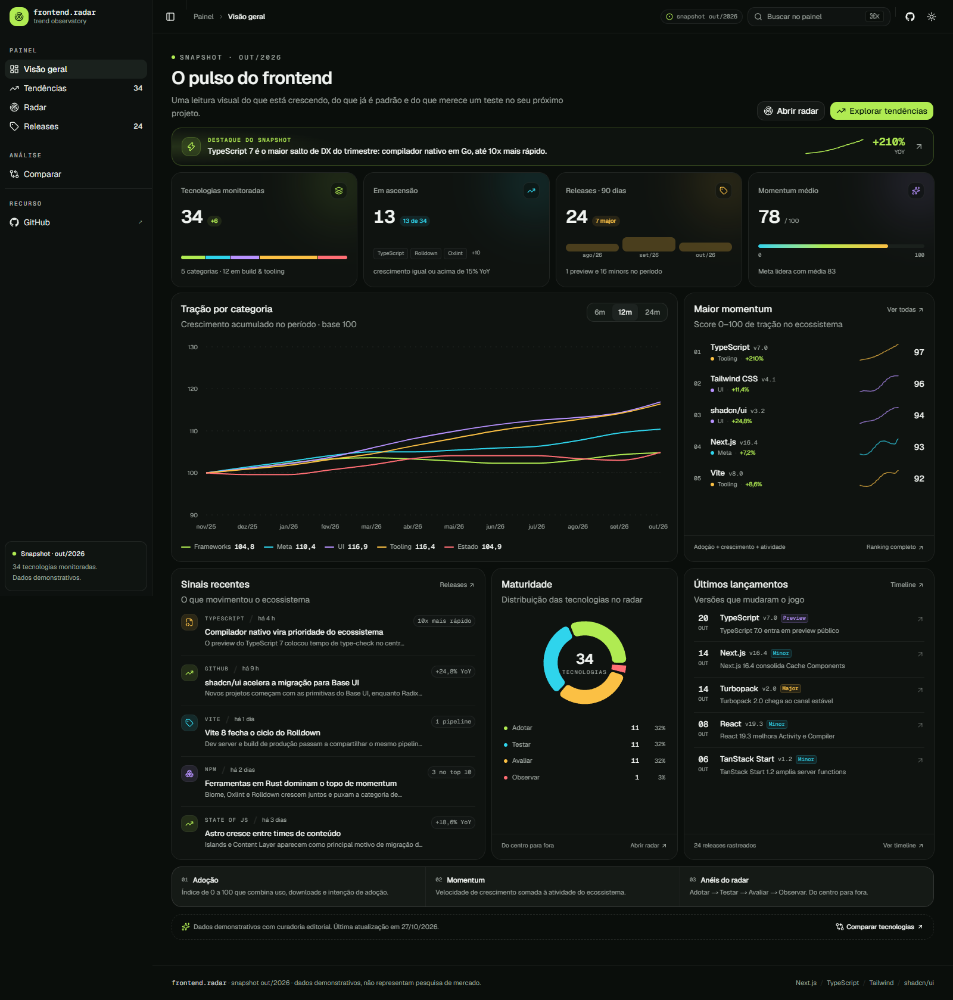

# Frontend Radar

Dashboard interativo para acompanhar **tendências, releases e maturidade das tecnologias do ecossistema frontend**.

[](https://github.com/mvnulman/frontend-dashboard/actions/workflows/ci.yml)
[](https://nextjs.org)
[](https://www.typescriptlang.org)
[](https://tailwindcss.com)
[](https://ui.shadcn.com)



## O que é

O **Frontend Radar** transforma um snapshot curado do ecossistema em uma experiência de leitura visual: índice de adoção, momentum, maturidade, categorias, releases e comparações lado a lado.

O painel foi desenhado para ser **estático, rápido e navegável**, com foco em visualização de dados, microinterações e leitura confortável em desktop e mobile.

> Os dados são **demonstrativos e editoriais**. Não representam uma pesquisa de mercado, benchmark oficial ou medição em tempo real. O snapshot exibido é de **outubro de 2026**.

## Funcionalidades

- **Visão geral** com KPIs, destaque do snapshot, gráfico de tração por categoria, líderes de momentum, distribuição de maturidade, sinais recentes e últimos lançamentos.
- **Catálogo de tendências** com busca tolerante a acentos, filtros por categoria e maturidade, ordenação, visualização em grade/lista, ficha detalhada e exportação CSV.
- **Radar interativo** em SVG com cinco setores, quatro anéis de maturidade, filtros por categoria, painel “em foco” e índice completo por categoria.
- **Timeline de releases** agrupada por mês, com filtros por tipo e categoria, resumo do trimestre, cadência mensal e distribuição de impacto.
- **Comparador** de até três tecnologias com presets, radar chart de scores, leitura rápida e ficha técnica com melhores valores destacados.
- **Command palette** (`⌘K` / `Ctrl+K`) para navegar, buscar tecnologias, alternar tema e copiar o link da página.
- **Tema claro e escuro** com `next-themes` e detecção de preferência do sistema.
- **Responsivo** de 320 px a telas amplas, com sidebar em sheet no mobile.
- **Acessibilidade** auditada com axe (teclado, landmarks, labels, contraste e `prefers-reduced-motion`).
- **Dados tipados** e séries determinísticas — sem backend ou banco de dados.

## Stack

| Camada | Escolha |
| --- | --- |
| Framework | Next.js 16 (App Router, Cache Components, Turbopack) |
| Linguagem | TypeScript strict |
| Estilo | Tailwind CSS v4 |
| Componentes | shadcn/ui (Base UI primitives) |
| Gráficos | Recharts + shadcn `chart` |
| Ícones | Lucide React |
| Tema | next-themes |
| Toasts | Sonner |
| Testes | Vitest |
| Qualidade | ESLint + `tsc --noEmit` |

## Rotas

| Rota | Descrição |
| --- | --- |
| `/` | Visão geral e sinais do snapshot |
| `/tendencias` | Catálogo filtrável de tecnologias |
| `/radar` | Radar de adoção e maturidade |
| `/releases` | Timeline de lançamentos |
| `/comparar` | Comparação de 2–3 tecnologias |

## Rodando localmente

Requisitos: **Node.js 22+** e npm.

```bash
npm install
npm run dev
```

Abra [http://localhost:3000](http://localhost:3000).

Opcionalmente, configure a URL pública usada para resolver a imagem de Open Graph:

```bash
cp .env.example .env.local
# edite NEXT_PUBLIC_SITE_URL
```

## Scripts

```bash
npm run dev        # servidor de desenvolvimento
npm run build      # build de produção
npm run start      # servidor de produção
npm run lint       # ESLint
npm run typecheck  # TypeScript sem emitir arquivos
npm run test       # Vitest
npm run check      # lint + typecheck + testes
```

## Estrutura

```text
src/
├── app/
│   ├── (dashboard)/        # rotas do painel + shell
│   ├── layout.tsx          # fontes, tema, metadata e toaster
│   ├── opengraph-image.tsx # OG image gerada em runtime
│   └── globals.css         # tokens, tema e utilitários
├── components/
│   ├── dashboard/          # blocos da visão geral
│   ├── tendencias/         # catálogo, cards e filtros
│   ├── radar/              # SVG e painel do radar
│   ├── releases/           # timeline e resumo
│   ├── compare/            # comparador e radar chart
│   ├── shell/              # sidebar, header e command palette
│   └── ui/                 # shadcn/ui
└── lib/
    ├── data.ts             # dataset e séries derivadas
    ├── types.ts            # contratos do domínio
    ├── format.ts           # formatadores pt-BR
    └── csv.ts              # exportação CSV
tests/                      # testes de integridade dos dados
```

## Dados

- **34 tecnologias** em 5 categorias: frameworks, meta-frameworks, UI & estilo, build & tooling e dados & estado.
- **4 anéis** de maturidade: adotar, testar, avaliar e observar.
- **24 releases** entre agosto e outubro de 2026.
- As séries históricas são calculadas de forma determinística a partir do índice atual e do crescimento YoY, apenas para visualização.
- Os scores editoriais (DX, performance, ecossistema, facilidade de aprendizado e estabilidade) existem para enriquecer a comparação e **não são benchmarks**.

Para atualizar o snapshot, edite `src/lib/data.ts` — o restante do painel é derivado desse arquivo.

## Deploy

O projeto é compatível com Vercel, qualquer host Node.js ou exportação estática das rotas. Em produção, defina:

```env
NEXT_PUBLIC_SITE_URL=https://seu-dominio.com
```

## Autor

Feito por [mvnulman](https://github.com/mvnulman).

Se este projeto foi útil, deixe uma estrela no repositório.
